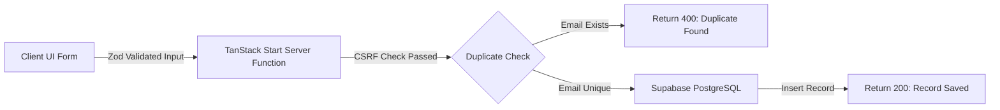

# 🛡️ Data Redundancy Removal System (DRRS)

[](https://react.dev/)
[](https://www.typescriptlang.org/)
[](https://tanstack.com/start)
[](https://supabase.com/)
[](https://tailwindcss.com/)
[](https://opensource.org/licenses/MIT)

> A modern, full-stack cloud data ingestion platform designed to eliminate duplicate entries and prevent data redundancy in real time. Built for speed, security, and developer ergonomics.

---

## 🌟 Key Features

- **⚡ Real-Time Redundancy Detection**: Automatically verifies incoming records before insertion to guarantee that emails remain 100% unique across the dataset.
- **🔒 Secure Server-Side RPC Functions**: Powered by TanStack Start `createServerFn` with built-in CSRF middleware and secure backend execution.
- **🗄️ Supabase PostgreSQL Backend**: Database-level constraints paired with Row-Level Security (RLS) and service-role administrative controls.
- **✨ Polished User Experience**: Modern, accessible UI powered by Tailwind CSS v4, Radix UI primitives, Lucide icons, and Sonner toast notifications.
- **🛡️ End-to-End Type Safety**: Input validation using **Zod** paired with **React Hook Form** for instantaneous client feedback and strict server-side verification.

---

## 🏗️ Architecture & How It Works



1. **Client Submission**: The user submits their name and email through a responsive form validated locally by Zod.
2. **Server Function RPC**: The request is routed to a server function protected by same-origin CSRF middleware.
3. **Redundancy Validation**: The server queries the database for existing records with the given email.
4. **Duplicate Handling**: If a match is discovered, a friendly duplicate error is thrown; otherwise, the record is atomically saved.

---

## 🚀 Tech Stack

| Layer | Technology |
|---|---|
| **Framework** | [TanStack Start](https://tanstack.com/start) + [TanStack Router](https://tanstack.com/router) |
| **Frontend** | [React 19](https://react.dev/), [TypeScript](https://www.typescriptlang.org/) |
| **Styling** | [Tailwind CSS v4](https://tailwindcss.com/), Radix UI Primitives |
| **State & Data Fetching** | [TanStack React Query](https://tanstack.com/query) |
| **Form Management** | [React Hook Form](https://react-hook-form.com/) + [Zod](https://zod.dev/) |
| **Database** | [Supabase](https://supabase.com/) (Managed PostgreSQL) |
| **Build Tool** | [Vite 8](https://vitejs.dev/) |

---

## 📁 Project Structure

```text
├── src/
│   ├── components/        # Reusable UI components (buttons, forms, inputs)
│   ├── integrations/      # Supabase client and auth configurations
│   │   └── supabase/
│   │       ├── client.ts         # Client-side Supabase instance
│   │       └── client.server.ts  # Server-side administrative client
│   ├── lib/
│   │   └── records.functions.ts  # Server functions for database operations
│   ├── routes/
│   │   ├── __root.tsx     # Root document layout & error boundaries
│   │   └── index.tsx      # Main application page with submission form
│   ├── routeTree.gen.ts   # Auto-generated TanStack router tree
│   ├── server.ts          # Server entrypoint
│   └── start.ts           # TanStack Start instance with CSRF middleware
├── supabase/
│   └── migrations/        # SQL schema & RLS policies
├── .env.example           # Environment variable template
├── package.json
└── vite.config.ts
```

---

## ⚙️ Getting Started

### Prerequisites

- **Node.js** `>= 18.0.0`
- **npm** or **bun** / **pnpm**
- A **Supabase** project ([create one for free](https://supabase.com))

### 1. Clone the Repository

```bash
git clone https://github.com/Nibedita433/codealpha_dataredundancyremoval.git
cd codealpha_dataredundancyremoval
```

### 2. Install Dependencies

```bash
npm install
```

### 3. Setup Environment Variables

Copy the example environment file:

```bash
cp .env.example .env
```

Open `.env` and fill in your Supabase credentials:

```env
SUPABASE_URL="https://your-project.supabase.co"
SUPABASE_PUBLISHABLE_KEY="your_publishable_key"
SUPABASE_SECRET_KEY="your_secret_or_service_role_key"

VITE_SUPABASE_URL="https://your-project.supabase.co"
VITE_SUPABASE_PUBLISHABLE_KEY="your_publishable_key"
```

> 💡 **Tip**: `.env` and `.env.local` are automatically ignored by Git to protect your secret keys.

### 4. Create the Database Table

In your [Supabase SQL Editor](https://supabase.com/dashboard), run the following query:

```sql
CREATE TABLE IF NOT EXISTS public.records (
  id UUID NOT NULL DEFAULT gen_random_uuid() PRIMARY KEY,
  name TEXT NOT NULL,
  email TEXT NOT NULL UNIQUE,
  created_at TIMESTAMPTZ NOT NULL DEFAULT now()
);

GRANT ALL ON public.records TO service_role;
```

### 5. Run Development Server

```bash
npm run dev
```

Open [http://localhost:8080](http://localhost:8080) (or the port displayed in your terminal) to view the application.

---

## 📦 Building for Production

To create a production-ready build:

```bash
npm run build
```

To preview the built production bundle locally:

```bash
npm run preview
```

---

## 🌐 Deployment (Vercel)

1. Push your repository to GitHub.
2. Import the repository in [Vercel](https://vercel.com).
3. Under **Project Settings ➔ Environment Variables**, add:
   - `SUPABASE_URL`
   - `SUPABASE_PUBLISHABLE_KEY`
   - `SUPABASE_SECRET_KEY` (or `SUPABASE_SERVICE_ROLE_KEY`)
4. Click **Deploy**.

---

## 📄 License

This project is licensed under the [MIT License](LICENSE).
